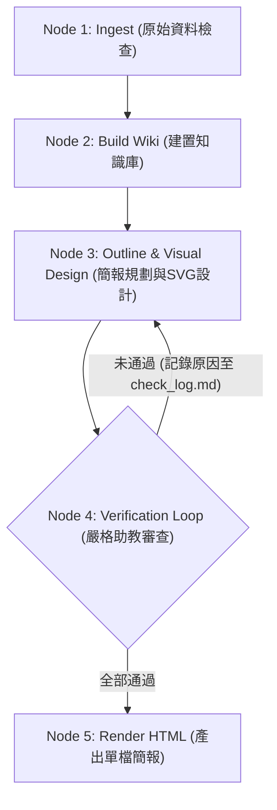

# 大地測量學（Geodesy）LLM Wiki 與教學簡報專案工作手冊 (agent.md)

本文件為本專案的唯一核心工作手冊與行為規範準則。AI Agent 必須嚴格遵守以下所有規範與流程。

---

## 1. 專案目標

本專案旨在將 `raw/` 資料夾內的大地測量學原始筆記／文獻資料，系統化轉化為結構化的繁體中文 Markdown 知識庫（`wiki/`），並在此基礎上進一步轉化為適合零基礎初學者閱讀的圖文教學型單一 HTML 簡報（`slides/index.html`）。

---

## 2. 資料夾結構與命名規範

```text
.
├── agent.md              # 本手冊（專案唯一規範）
├── check_log.md          # 品質審查歷程與修正紀錄
├── raw/                  # 原始資料夾（只讀層）
├── wiki/                 # 結構化 Markdown 知識庫
│   ├── index.md          # 知識庫總目錄與概念關聯索引
│   └── topic_XX_主題.md   # 主題條目（XX 為兩位數流水號，例如 topic_01_大地水準面.md）
└── slides/               # 簡報輸出資料夾
    └── index.html        # 單一獨立 HTML 簡報檔（內嵌 CSS、JS、SVG）
```

### 資料夾與檔案守則：
1. **`raw/`（只讀層）**：存放原始文字檔、PDF 筆記或文獻。**AI 絕對不可修改、移動或刪除此資料夾中的任何檔案。**
2. **`wiki/`（知識層）**：
   - 所有條目一律採用繁體中文撰寫。
   - 檔名格式一律為 `topic_XX_主題名稱.md`（例如：`topic_01_地球形狀與大地水準面.md`、`topic_02_參考橢球體與座標系統.md`）。
   - 必須同步維護 `wiki/index.md`，作為整個知識庫的總覽目錄、條目摘要與雙向概念關聯索引。
3. **`slides/`（呈現層）**：
   - 輸出單一獨立網頁簡報檔 `slides/index.html`。
   - 所有樣式（CSS）、互動邏輯（JavaScript）以及幾何示意圖（SVG）必須完全內嵌於該單一檔案中，確保無外部依賴，可直接離線瀏覽或部署於 GitHub Pages。
4. **`check_log.md`（審查紀錄）**：
   - 每次執行品質審查（Verification Loop）時，必須詳細記錄檢查輪次、審查意見、未通過原因以及修正動作。

---

## 3. Graph + Loop 工作流程定義

專案遵循嚴格的節點流水線與品質反饋循環（Verification Loop）：



### Node 1: Ingest（資料盤點與檢視）
- 掃描 `raw/` 目錄內的所有原始檔案（文字檔、Markdown 或 PDF）。
- 確認來源檔案數量至少達 **5 篇**。
- 若不足 5 篇，應明確提示使用者補充來源檔案。

### Node 2: Build Wiki（建置知識庫）
- 深入解析 `raw/` 內的所有原始文獻，將知識體系拆解為具備主題性的條目檔案（`wiki/topic_XX_主題名稱.md`）。
- 同步建立與更新 `wiki/index.md`（包含主題列表、核心概念、雙向關聯矩陣）。
- **【核心鐵則】嚴禁幻覺與編造**：所有名詞定義、數學物理公式、數值參數（如 GRS80、WGS84 橢球參數、TWD97 定義等），必須 **100% 來自 `raw/`**，嚴禁 AI 自行發明、揣測或引入外部未驗證內容。

### Node 3: Outline & Visual Design（教學簡報大綱與視覺化設計）
- 依據 `wiki/` 的條目內容，規劃專為零基礎新手設計的教學簡報大綱。
- 將深奧的大地測量概念（如大地水準面起伏、正高 vs 橢球高、七參數坐標轉換等）轉化為生活化比喻與淺顯易懂的階梯式教學。
- **內嵌 SVG 視覺圖解規範**：每個核心概念都必須搭配精心設計的「內嵌原生 SVG 幾何／原理示意圖」，清楚標示幾何曲面、法線、物理力線與符號。**嚴禁使用外部圖片 URL**，避免網路斷線或破圖。

### Node 4: Verification Loop（嚴格助教視角審查）
- 模擬「資深且挑剔的大地測量學助教」，逐頁逐項檢驗簡報大綱與內容：
  1. **來源溯源度**：是否 100% 對應 `wiki/` 內容？每頁是否標註所引用的 `wiki/topic_XX` 出處？
  2. **圖解精準度**：內嵌 SVG 圖解幾何關係是否正確無誤？標註是否清楚易懂？
  3. **教學友善度**：專有名詞是否有白話文解說與輔助說明？零基礎初學者是否能無障礙理解？
- **循環機制**：若有任何一項未達標準，必須退回 Node 3 進行修訂，並將該輪的「檢查時間、輪次、審查意見、修正措施」如實記錄於 `check_log.md`。唯有審查全數通過，方可進入下一節點。

### Node 5: Render HTML（生成最終簡報）
- 產出極致美觀、專業的單一檔案 `slides/index.html`。
- **功能要求**：
  - 支援鍵盤左／右方向鍵（Arrow Left / Right）及空白鍵（Space）切換投影片。
  - 包含即時進度條（Progress Bar）與頁碼計數器。
  - 響應式排版，文字與公式（LaTeX 風格排版）清晰美觀。
  - 完全內嵌所有 CSS、JS 與 SVG 圖形，無任何外部資源依賴。

---

## 4. 安全與合規底線

- **資料保護**：絕對不可在專案內的任何檔案（包括 wiki、程式碼、簡報、紀錄檔）中寫入任何個人隱私資訊、真實帳號、密碼、Token 或 API Key。
- **資料完整性**：始終維持 `raw/` 的不可變性（Immutable），確保原始資料來源的純淨與可溯源性。
