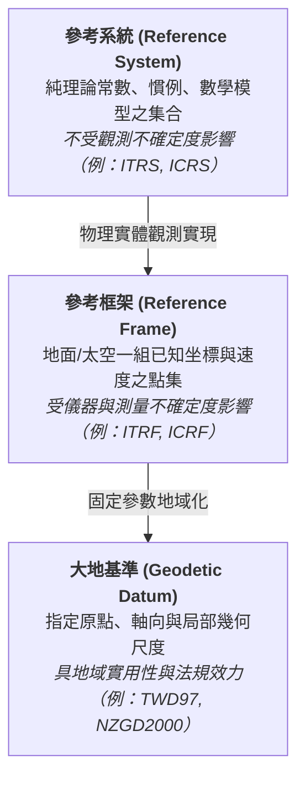

# 主題 07：國際參考框架與現代動態基準

> **資料來源標註**：本條目所有定義、原則、參數與各國案例 100% 摘錄自原始文獻 `raw/01.pdf.pdf`（名詞解釋 一-5、申論 比較 4、6、7、8）與 `raw/03.md.md`（第四節）。

---

## 一、參考系統、參考框架與基準之層次劃分

依據 `raw/01.pdf.pdf`（名詞解釋 一-5、申論 比較 4）與 `raw/03.md.md`，大地測量嚴格區分三個層次：

- **三大層次本質特徵**：
  1. **參考系統（純理論）**：概念性定義，不受測量誤差影響。
  2. **參考框架（物理實現）**：透過可觀測物理點的坐標來實現系統。「框架無系統不能存在，系統無框架無實用價值。」
  3. **基準（工程與地域實用）**：給定特定參數將框架與系統固定，以利國家測圖與工程應用。

---

## 二、ITRS（國際地球參考系統）與 ITRF（框架）

依據 `raw/01.pdf.pdf`（名詞解釋 一-5）與 `raw/03.md.md`：

### 1. ITRS 建立的四大定義條件
1. **地心定義**：原點為包含海洋和大氣質量的整個地球質心。
2. **長度尺度**：長度單位為國際標準公尺（SI），尺度與地心坐標時（TCG）一致。
3. **初始定向**：定向初始取國際時間局（BIH）1984.0 的定向。
4. **定向隨時間演化**：隨時間變化滿足對全球水平板塊運動的**「無淨旋轉條件」（No-Net-Rotation, NNR）**。

### 2. ITRF 的內容與歷代版本
- **核心內容**：全球數百個空間測站的三維精確坐標與速度場（$\mathbf{X}, \dot{\mathbf{X}}$）、DOMES 國際統一編號、站點目錄與局部空間連結向量（ITRF2008 另含 EOP 序列）。
- **版本命名規則**：`ITRFyy`，其中 $yy$ 代表框架解算所納入觀測資料的最後截止年份（如 ITRF89、...、ITRF94、ITRF2000、ITRF2008、ITRF2014、ITRF2020）。

### 3. 全球大地參考框架決議（GGRF）
2015 年 2 月 26 日，聯合國大會正式通過《促進永續發展之全球大地參考框架》（GGRF）決議（由 UN-GGIM 提出），由 ITRF、ICRF 與物理高程系統共同實現，確立高精度全球測地框架在經濟發展、防災與地球科學中的基礎戰略地位。

---

## 三、五大空間測地技術（Space Geodetic Techniques）

依據 `raw/01.pdf.pdf`（名詞解釋 一-5、申論 比較 8）與 `raw/03.md.md`，ITRF 框架由以下五大空間測地技術聯合平差解算實現：

| 測地技術 | 英文全稱 | 觀測原理與精度特點 | 專責國際服務組織 |
| :--- | :--- | :--- | :--- |
| **VLBI** | Very Long Baseline Interferometry（超長基線干涉測量） | 觀測遙遠河外射電源（類星體）微波抵達地面站的時間差。**唯一能獨立測定全部地球定向參數（EOP）全部分量的技術**；精度約 $\pm 0.2\text{ mas}$；負責維持天球框架 ICRF。 | **IVS** |
| **SLR** | Satellite Laser Ranging（衛星雷射測距） | 量測短脈衝雷射往返專用反射衛星（LAGEOS-1 高度 5900 km、LAGEOS-2）的雙程時間（$\rho \approx c\Delta t/2$）。單脈衝精度 $< 1\text{ cm}$；**對地球質心極為敏感，決定框架原點**。 | **ILRS** |
| **LLR** | Lunar Laser Ranging（月球雷射測距） | 量測雷射往返月球表面阿波羅等四個反射鏡的時間，用於測定黃道傾角、長週期章動與引力物理常數。 | **ILRS** |
| **GNSS / GPS** | Global Navigation Satellite System | 雙頻微波測距（1.227 與 1.575 GHz 消除電離層延遲），4 顆衛星同時解出三維位置與接收機鐘差。全球站點最密集，負責將框架加密至陸地各區域。 | **IGS** |
| **DORIS** | Doppler Orbitography and Radiopositioning Integrated by Satellite | **上行都卜勒系統**：地面信標（約 50 個）發射、衛星接收，天然集中式結構。測站定位精度 1–2 cm，長期監控地心與極移。 | **IDS** |

---

## 四、基準演進：靜態 $\to$ 半動態 $\to$ 動態（時變）

依據 `raw/01.pdf.pdf`（名詞解釋 一-5、申論 比較 6）與 `raw/03.md.md`：

### 1. 演進類型比較
1. **靜態基準（Static Datum）**：
   - 國家基準對齊某一版本 ITRF 在特定參考曆元（Reference Epoch）的坐標後，數值永久凍結固定（如臺灣早期 TWD97 對齊 1997.0）。
   - **痛點**：板塊構造運動、斷層滑移與地震會使地面點位持續位移，靜態坐標與真實地表隨時間脫節，控制點精度逐漸破壞。
2. **時變／動態基準（Dynamic / Time-dependent Datum）**：
   - 控制點坐標直接作為時間的連續函數：$\mathbf{X}(t) = \mathbf{X}(t_0) + \mathbf{V}(t - t_0)$。
   - **痛點**：土地地籍產權界址、工程設計圖資每天坐標都在變動，嚴重衝擊地政行政法規與社會穩定。
3. **半動態基準（Semi-dynamic Datum）**：
   - 官方坐標仍維持在某固定參考曆元（便於一般地籍與工程製圖）。
   - 當進行新測量時，透過官方公布的**地殼變形模型（Deformation Model）**，將不同時刻之實際 GNSS 觀測量逆向「倒推回」基準參考曆元，消除板塊運動累積的形變誤差。

### 2. 國際典型代表案例
- **紐西蘭 NZGD2000**（1998 年發布、2000 年實施）：全球半動態基準的經典先驅。變形模型包含：①長期線性板塊趨勢、②區域應變變形、③大地震震後位移（如基督城地震補正）。
- **澳洲雙框架策略（GDA2020 / ATRF2014）**：
  - **GDA2020**：靜態基準（固定曆元 2020.0）。
  - **ATRF2014**：時變動態框架（直接對齊 ITRF2014）。
  - 兩者以十四參數相似轉換與 APREF 板塊模型無縫連接。
- **日本 JGD2024**：
  - 國土地理院（GSI）採用「定常時地殼變動補正」（半動態）修正長期板塊擠壓。
  - 另設「非常態狀態補正」針對大地震與火山活動產生的突發位移進行專案補正。
- **歐洲 ETRS89**：
  - 固定於穩定的歐亞板塊構造上，參考曆元 1989.0。與全球 ITRF 之間每年因歐亞板塊漂移累積約 2.5 cm/yr 之相對位移。

---

## 五、臺灣大地基準雙框架策略（TWD97 ＋ TTRF）

依據 `raw/01.pdf.pdf`（名詞解釋 一-5、申論 比較 7）與 `raw/03.md.md`（第四節 第 2 點）：

### 1. 臺灣面臨的嚴峻測地挑戰
- 臺灣本島地處歐亞板塊與菲律賓海板塊碰撞交界帶，地殼變形速率高達數公分/年，加之地震頻發（如 921 集集大地震、花蓮地震）。
- 靜態 TWD97 基準控制點位移迅速累積，歷史上已先後被迫更新出三個官方版本：
  - **TWD97**（曆元 1997.0）
  - **TWD97[2010]**（曆元 2010.0）
  - **TWD97[2020]**（曆元 2020.0）
- 每隔十年大規模重算更新，給土地地籍界址確認、都市計畫圖資疊加及工程建設法規帶來巨大紛擾。

### 2. 雙框架架構設計（TWD97 ＋ TTRF）
為徹底兼顧「公法地籍穩定性」與「現代空間資訊即時高精度」，內政部研擬**雙框架策略**：
1. **法定靜態基準：TWD97**
   - 繼續作為法定地籍測量與工程圖資的固定基準（維持 TWD97[2020] 成果），確保土地權益永久不變動。
2. **高精度動態時變框架：TTRF（Taiwan Terrestrial Reference Frame）**
   - 以全臺密布的連續衛星追蹤站網（CORS）即時解算，**直接對齊最新的國際框架 ITRF2020**，坐標隨時間連續動態演化。
3. **地殼變位模型（Crustal Deformation Model）**
   - 開發高解析度三維地殼速度場與位移網格模型，作為連接時變 TTRF 與法定靜態 TWD97[2020] 的幾何橋樑。
- **實證成果**：文獻記載經由 LiDAR 加密控制點、29 個一等衛星控制點與 28 個外業檢測點驗證，利用地殼變位模型能有效將測區內板塊變形誤差消除，使外業檢核殘差大幅降低。
